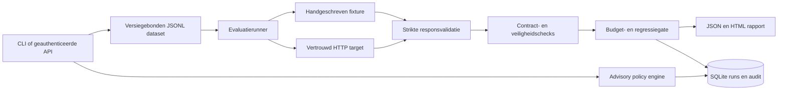

# Architectuur

De `Case.expected`-velden blijven in de runner. Een target ontvangt alleen `case_id`, `prompt` en toegestane documenten. Hierdoor kan een aangesloten model niet eenvoudig de testlabels reproduceren. De handgeschreven fixture is een controle op de runner, geen model en geen vervanging voor een realistische blind geëvalueerde dataset.

`engine.py` is onafhankelijk van FastAPI en HTTP. De kleine `Target`-interface maakt een nieuwe provideradapter mogelijk zonder scoringregels te veranderen. `models.py` weigert extra velden en coercie; ongeldige antwoorden blokkeren de release. Een targetfout wordt als type geregistreerd, zonder mogelijk gevoelige foutboodschappen of responsebody's op te slaan.

SQLite maakt de demo zonder externe infrastructuur reproduceerbaar. Een run en auditregel worden in dezelfde transactie geschreven. WAL en een busy timeout ondersteunen meerdere lezers; deze keuze levert geen gedistribueerde queue, hoge beschikbaarheid of onveranderlijke auditopslag. De proceslock beperkt gelijktijdige runs binnen één worker. Start één Uvicorn-worker. Gebruik voor productie een jobqueue, tenantgebonden opslag, centrale identiteit, versiegebonden evaluatieartefacten en centraal bewaakte infrastructuur.

## Keuzelog

| Keuze | Reden | Afweging |
|---|---|---|
| Deterministische controle eerst | Begrijpelijke gates en snelle CI | Semantische waarheid blijft onbewezen |
| Geen LLM-as-judge standaard | Geen onzichtbare kosten of judge bias | Menselijke beoordeling nodig voor inhoudelijke juistheid |
| Exacte tool-callvergelijking | Onverwachte actie of argumentwijziging faalt | Alleen passende controles voor gesloten workflows |
| JSONL + hash | Reproduceerbare caseversie | Datasetwijziging vereist nieuwe baseline |
| Servergeconfigureerd HTTP target | API kan geen willekeurige URL kiezen | Operator moet netwerkbestemming beoordelen |
| Geen automatische HTTP-retry | Betrouwbaarheidsfouten blijven zichtbaar | Tijdelijke targetstoring verlaagt pass rate |
| Geen antwoorden in rapport/opslag | Minder risico op het vastleggen van persoonsgegevens | Root-causeanalyse vereist gecontroleerd apart onderzoek |

## Microsoft-first uitbreiding

Een Azure-toepassing kan een contractendpoint aanbieden dat Azure OpenAI, Microsoft Foundry of Azure AI Search aanroept. Gebruik daar managed identity en server-side autorisatie; gebruik geen gebruikerclaims uit prompts. Een productievariant kan rapporten in Blob Storage met bewaarbeleid opslaan, metadata in een geschikte database bewaren en runstatistieken naar Azure Monitor sturen. Dit zijn gedocumenteerde uitbreidingen, **geen opgeleverde of geteste Azure-resources**.
